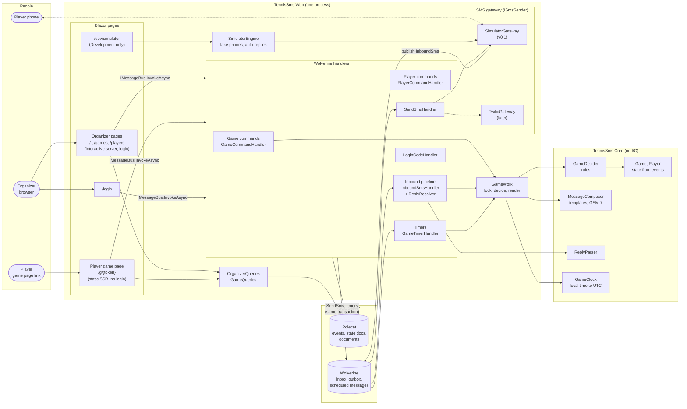
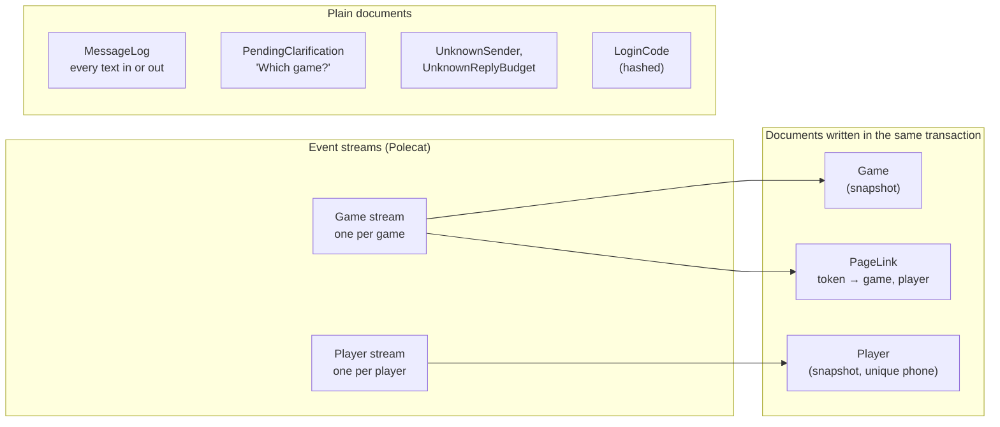
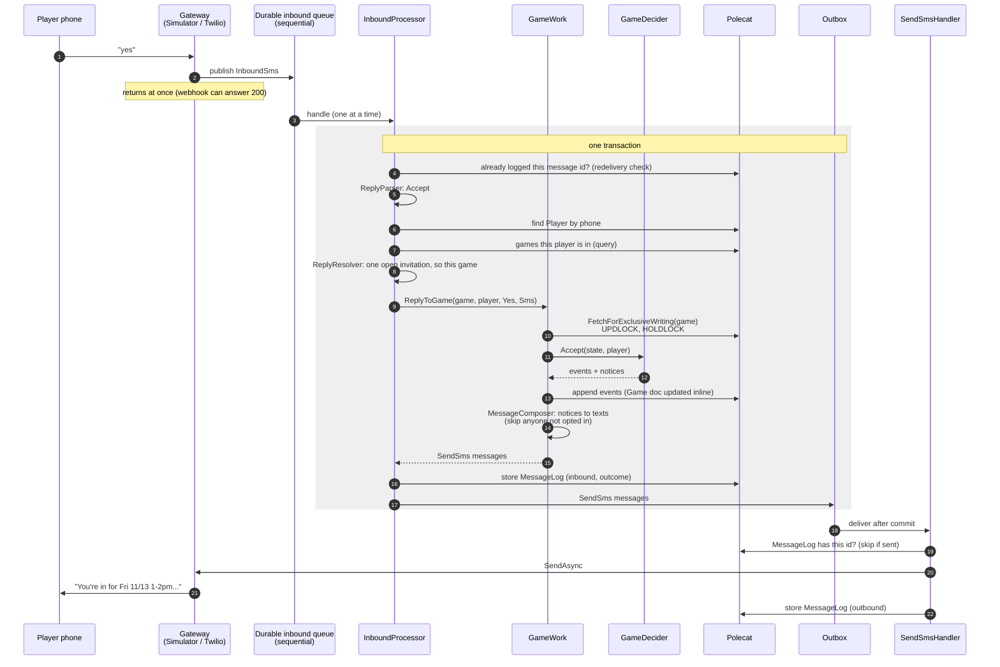
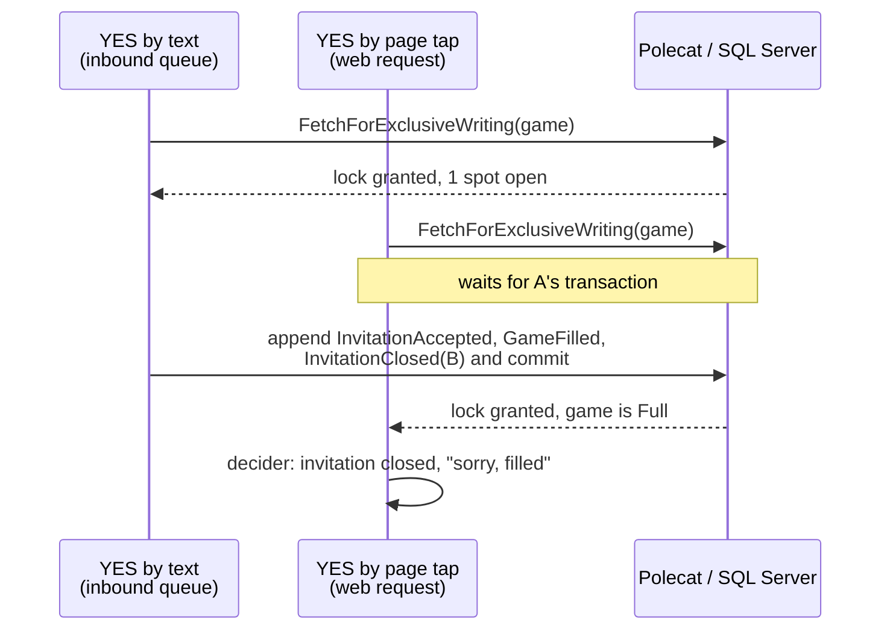
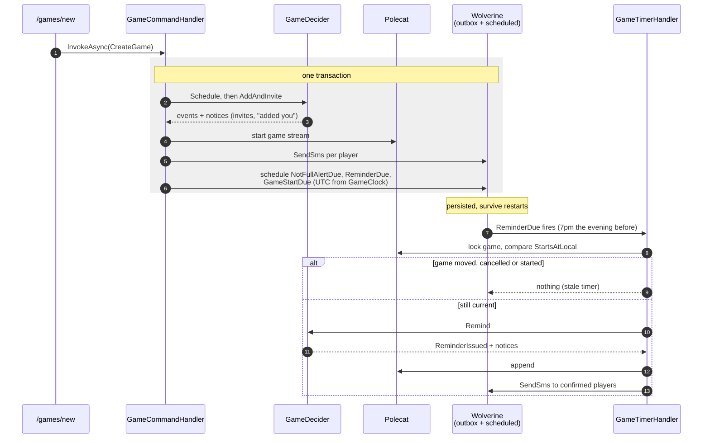
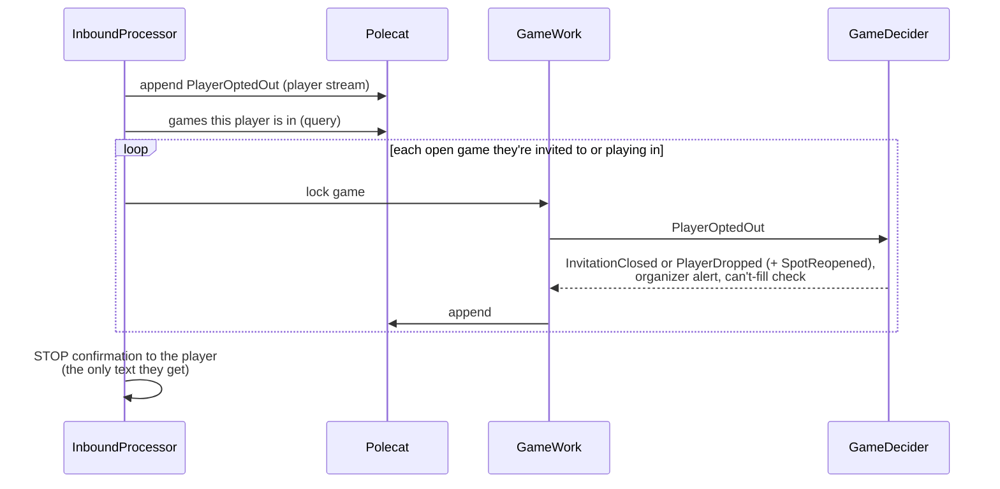
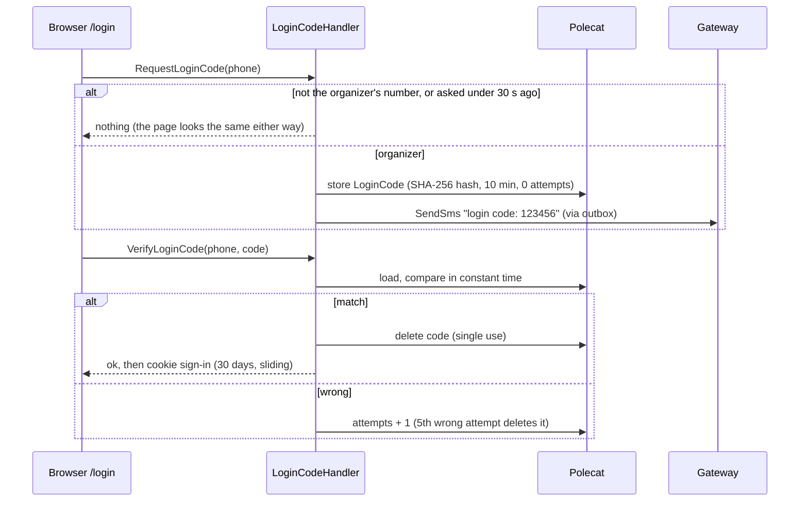

# Architecture

How TennisSMS is put together, and how a text moves through it. Describes v0.1 as built. For behavior and rules, see [spec-v0.1.md](spec-v0.1.md). This page is about structure.

The diagrams are Mermaid; GitHub and Visual Studio's Markdown preview render them.

## 1. The shape in one paragraph

One ASP.NET Core process does everything. **Core** is pure domain logic: given a game's current state and a command, `GameDecider` returns the events to record and the texts to send (as "notices"). **Web** wraps that in Wolverine handlers that load the game under a database lock, run the decider, append the events, and return outgoing texts. Polecat stores events, the current state of each game and player, and a few plain documents in SQL Server. Wolverine's transactional outbox commits the events and the outgoing texts in **one transaction**, then delivers the texts to the SMS gateway. Inbound texts and timers come in through Wolverine's durable local queues, so nothing is lost on a restart. The SMS gateway is an interface. In v0.1 the only implementation is the phone simulator, and Twilio slots in later without touching anything else.

## 2. Components

| Part | Where | What it owns |
|---|---|---|
| `GameDecider` | `Core/Games` | Every game rule. Pure: state + command → events + notices. No clock, database or randomness except what's passed in |
| `Game`, `Player` | `Core/Games`, `Core/Players` | Current state, built by applying events. Polecat stores them as inline snapshots |
| `MessageComposer` | `Core/Messages` | Turns notices into text. Every template fits one GSM-7 segment |
| `ReplyParser` | `Core/Replies` | Text → intent (YES, NO, OUT, JOIN, STOP, HELP, 1/2, …) |
| `GameClock` | `Core/Time` | The one place local game times become UTC instants (cutoff, reminder, start) |
| `GameWork` | `Web/Games` | The shared steps of every game command: lock the stream, run the decider, append events, render notices into `SendSms` messages (checking consent again) |
| Game and player handlers | `Web/Games`, `Web/Players` | Organizer commands, player replies from the page, timers, organizer setup at startup |
| Inbound pipeline | `Web/Inbound` | Log every text, find the sender, parse, resolve which game, apply. Unknown numbers and the "Which game?" question live here |
| `SendSmsHandler` | `Web/Sms` | The only caller of the gateway. Skips duplicates, logs every outbound text |
| `ISmsSender` + gateways | `Web/Sms` | The provider boundary. Nothing outside an adapter knows which provider is in use |
| Simulator | `Web/Simulator`, `/dev/simulator` | Fake phones, auto-replies, scenarios. Registered only with the Simulator gateway |
| Queries | `Web/Organizer`, `Web/Games` | Reads for pages and the resolver: plain queries over the stored `Game` and `Player` documents |

**Dependency rule.** Core references nothing but JasperFx.Events, and only for Polecat's source generator. Everything that does I/O is in Web. Pages never call the database to change anything: they send commands through Wolverine, in process.

## 3. Data

- **Game stream events:** `GameScheduled`, `GameDetailsChanged`, `PlayerAddedByOrganizer`, `PlayerInvited`, `InvitationAccepted`, `InvitationDeclined`, `GameFilled`, `InvitationClosed`, `PlayerDropped`, `PlayerRemovedByOrganizer`, `SpotReopened`, `GameCancelled`, `GameStarted`, and the markers `ReminderIssued`, `CancellationWindowAlertIssued`, `ShortfallAlertIssued`.
- **Player stream events:** `PlayerRegistered`, `PlayerDetailsChanged`, `PlayerOptedIn`, `PlayerOptedOut`, `OrganizerRoleGranted`.
- "Which games is this player in" (for replies, STOP and pages) is a query over `Game` documents, not a projection. That's spec-v0.1 §4.5.
- **Wolverine's own tables** hold the durable inbox (inbound texts), the outbox (texts waiting to go out) and scheduled messages (timers), in the same database.

## 4. Flows

### 4.1 A player texts YES

The main path. Everything in the box commits together, or not at all.

Notes:
- **One text per number per command.** The decider combines notices before they leave (for example "you're in, game on" instead of two texts), so the rule is enforced in Core and tested there.
- **More than one game could match.** The resolver returns "needs a choice". The pipeline stores a `PendingClarification` and texts "Which game? 1) … 2) …". A later "2" loads it and continues at step 9 with that game.
- **A tap on the game page** (`/g/{token}`) skips steps 1–8. The page sends `ReplyToGame` with `Channel = Page` through `IMessageBus.InvokeAsync`, which reaches the same `GameWork` and decider, then redirects (post/redirect/get).

### 4.2 Two YESes for the last spot

Invariant: confirmed never exceeds capacity. The exclusive stream lock is what guarantees it, not the sequential queue. A page tap and a text don't share a queue.

If a command still loses a race (`StreamLockedException` or `ConcurrencyException`), Wolverine retries it with a short cooldown, and the retry runs against the new state. An integration test runs this race against SQL Server.

### 4.3 Organizer creates a game; timers

- **Editing the start time** schedules a new set of timers. The old ones still fire, see that `StartsAtLocal` no longer matches, and do nothing. Nothing is ever cancelled or rescheduled in place.
- **Marker events** (`ReminderIssued`, `CancellationWindowAlertIssued`) make a timer that fires twice harmless. A start-time change clears them, so the moved game gets its own reminder.
- **Fire now** on the simulator page sends the same timer message immediately.

### 4.4 STOP

STOP touches several streams: the player's, and every game they're in or invited to. It all happens in one transaction.

### 4.5 Organizer login

### 4.6 Startup

1. In Development, create the database if it's missing.
2. Polecat applies schema changes. Wolverine creates its tables and starts its durability agent (mode `Solo`: one instance, no leader election).
3. `OrganizerSetup` makes sure the configured organizer is an opted-in player with the organizer role. It adds no events if that's already true.
4. Pending inbound texts, unsent outbox messages and due timers are picked up from the database.

## 5. Key decisions

Short reasons. The spec has the full rules.

| Decision | Why |
|---|---|
| Pure decider in Core, thin handlers in Web | Rules are tested as plain functions, with no database or Wolverine in the unit tests |
| Exclusive stream lock on every game change | The last-spot race is the one invariant that can't be wrong. The second writer waits, then sees the truth |
| Texts leave only through the outbox | Events and texts commit together. A crash can't record a YES without its reply, or send a reply for a YES that wasn't recorded |
| Durable, sequential inbound queue | The webhook returns at once, nothing is lost on restart, and replies are handled in arrival order |
| Timers as scheduled messages that check the start time when they fire | No in-memory schedule, and nothing to cancel when a game moves |
| Queries over `Game` documents instead of per-player projections | At one organizer's volume, a query can't drift out of step with the games |
| One app instance | Simple hosting and no coordination. Wolverine runs in `Solo` mode |
| Simulator goes through the real pipeline | What you watch on `/dev/simulator` is what Twilio will exercise. Scenarios double as end-to-end tests |
| Gateway behind `ISmsSender` / `InboundSms` | Twilio replaces the simulator without changes to Core or handlers |
